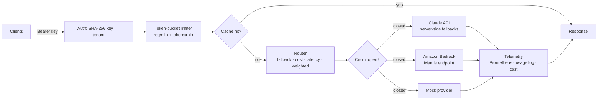

# LLM Gateway

One HTTP API in front of many LLM providers. It handles **routing, retries, cross-provider
failover, circuit breaking, response caching, per-tenant rate limits, and cost tracking**, and
comes with a live usage dashboard and Prometheus metrics.

It's built for the problem every team using LLMs in production runs into: you want to switch
models without redeploying clients, survive a provider outage, stop one tenant from using up the
shared quota, and know what you're spending.



## Features

| Area | What it does |
|---|---|
| **Routing** | Clients call a route alias (`smart`, `fast`, `balanced`) instead of a model ID. Four strategies: ordered `fallback`, cheapest-first `cost`, EWMA `latency`, and `weighted` (canary / A-B split). `provider/model` addresses a single model directly. |
| **Resilience** | Exponential-backoff retries for transient errors (429, 5xx, timeouts). A non-retryable error such as 403/404 moves straight to the next target. A 400 fails fast, since it would fail everywhere. Each target has a circuit breaker with a half-open probe. |
| **Claude refusals** | Opus 5.5 and Sonnet 5.5 requests set `fallbacks: "default"`, so a safety-classifier refusal is re-run on Anthropic's recommended fallback model inside the same call. |
| **Caching** | Exact-match cache keyed on a SHA-256 of the canonical request. Uses an in-memory LRU, or Redis when `REDIS_URL` is set. Refusals are never cached. Clients can opt out per request. |
| **Rate limits** | Two token buckets per tenant: requests/min and tokens/min. The full `max_tokens` budget is reserved up front, then reconciled against actual usage. Returns `429` with a `Retry-After` header. |
| **Multi-tenancy** | API keys are stored only as SHA-256 hashes and compared in constant time. Each tenant has an optional route allow-list, and an admin role gates the usage APIs. |
| **Streaming** | Server-Sent Events. Failover is transparent until the first byte is sent. A failure after that ends the stream with an `error` event. Rate-limit and auth errors are returned as real HTTP status codes, not inside a 200 stream. |
| **Observability** | Prometheus counters and histograms (requests, tokens, cost, cache hits, fallbacks, upstream latency), an `x-request-id` header on every response, and a `/dashboard` page. |

## Quick start (no API key needed)

```bash
pip install -e ".[dev]"
uvicorn gateway.main:app_factory --factory --port 8080
```

```bash
curl -s localhost:8080/v1/chat \
  -H "Authorization: Bearer sk-gw-local-dev" -H "content-type: application/json" \
  -d '{"model":"demo","messages":[{"role":"user","content":"Hello"}]}'
```

The `demo` route uses the mock provider. To populate the dashboard, run
`python scripts/loadtest.py --n 200`, then open <http://localhost:8080/dashboard> and connect
with `sk-gw-local-dev`. That key is a local development key defined in `config/gateway.yaml`;
replace it before deploying.

To use real models, set `ANTHROPIC_API_KEY` (and AWS credentials for the Bedrock routes) and
call `smart`, `balanced`, or `fast`.

### Full stack with Redis and Prometheus

```bash
cp .env.example .env
docker compose up --build
```

## API

| Method | Path | Auth | Description |
|---|---|---|---|
| `POST` | `/v1/chat` | tenant | `{model, messages, system?, max_tokens?, effort?, stream?, cache?}` |
| `GET` | `/v1/routes` | tenant | Routes this key can use |
| `GET` | `/admin/usage?window_minutes=60` | admin | Aggregates, time series, recent requests |
| `GET` | `/admin/circuits` | admin | Circuit breaker states |
| `GET` | `/metrics` | none | Prometheus exposition (keep it on a private network) |
| `GET` | `/healthz` | none | Liveness |

Every response includes `attempts[]`, so callers can see exactly which targets were tried and
why each one failed.

## Design decisions

- **The gateway owns retries, not the SDK.** The SDK client runs with `max_retries=0`, so retry
  budgets, backoff, and failover follow one policy and show up in `attempts[]`. Otherwise SDK
  retries would multiply with gateway retries.
- **Tokens are reserved, then reconciled.** Checking only prompt tokens lets a burst of
  long-output requests blow through the quota. Reserving `max_tokens` up front is strict, and
  crediting the unused part back afterwards keeps it fair.
- **Failover only before the first byte.** Replaying a half-delivered stream on another model
  would hand the client two different answers spliced together, so the gateway reports an error
  instead.
- **Circuits fail open when every target is down.** If all breakers are open, the gateway still
  tries the targets rather than returning 502 without making a call.
- **Prices live in config.** Pricing changes, and Bedrock is partner-priced, so the table in
  `config/gateway.yaml` is meant to be edited, not trusted blindly.

## Deploy to AWS

`deploy/terraform` provisions an App Runner service with autoscaling, a health check, the
Anthropic key in Secrets Manager, and a least-privilege instance role for Bedrock.

```bash
docker build -t llm-gateway . && docker push <ecr-uri>/llm-gateway:latest
cd deploy/terraform && terraform init && terraform apply -var image_uri=<ecr-uri>/llm-gateway:latest
```

## Tests

```bash
pytest -q        # 36 tests: routing, failover, circuits, limits, cache, SSE, SDK adapter
ruff check .
```

CI (`.github/workflows/ci.yml`) runs lint and tests on Python 3.11–3.13, builds the image, and
smoke-tests the container.

## Extending

To add a provider, implement `complete()` and `stream()` from `gateway/providers/base.py`, raise
`ProviderError(retryable=...)` on failure, and register it in `build_providers()`.
